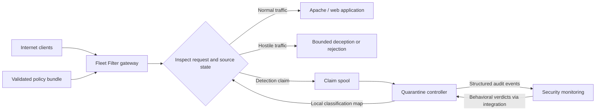
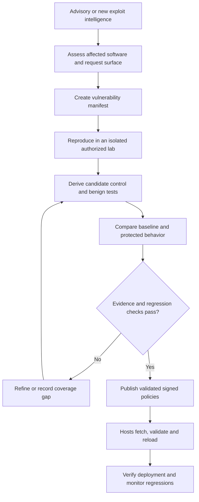
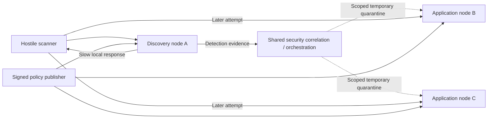

# Fleet Filter

**Zero-day defense for web infrastructure. Rapid virtual patching. Adaptive deception. Collective defense.**

[](LICENSE)
[](gateway/)
[](docs/EXPLOIT-CORPUS.md)

> **Detect the attack. Keep it away from the application. Slow the scanner. Give the rest of the fleet a head start.**

Fleet Filter is an open-source security gateway designed to protect web servers and applications during the most difficult part of vulnerability response: the period between learning about an exploit and deploying a permanent fix.

It places a purpose-built Rust reverse proxy in front of existing infrastructure, intercepts recognizable exploit attempts, and can prevent hostile requests from reaching vulnerable software. Rather than merely returning an error, it can respond with resource-bounded deception that occupies a scanner while the real application remains isolated from that request.

Fleet Filter is built around a second idea: **the work required to understand and stop a new exploit should be done once, not repeated independently on every server.** Versioned vulnerability rules, reproducible exploit tests, machine-readable security events and signed policy distribution provide the foundation for coordinated defense across an organization.

## Why Fleet Filter exists

A vulnerability can become exploitable long before every affected system can be updated. A vendor fix may not exist yet, a distribution package may be delayed, or an organization may need time to test and deploy an update safely. Automated scanners do not wait for maintenance windows.

Filtering inside the vulnerable server is not always enough, either. If the flaw is in the server's HTTP parser, a rule evaluated after parsing may never get a chance to protect it.

Fleet Filter moves the enforcement boundary in front of the origin and makes it possible to deploy **virtual patches** independently of the application or web server being protected. It is intended to buy time to patch properly, not to eliminate the need for patches.

### Three complementary defenses

| Defense | Purpose |
| --- | --- |
| **Protocol isolation** | Terminate and reconstruct requests outside the origin, removing certain exploit prerequisites before the application sees traffic. |
| **Exploit-specific filtering** | Intercept matching paths, protocol characteristics and body markers using rules derived from vulnerability research and tested against representative victims. |
| **Adaptive scanner quarantine** | Retain source classifications, incorporate behavioral detections and divert subsequent hostile requests away from the real application. |

Protocol isolation can protect against some previously unseen variants when they depend on a prerequisite that the gateway removes. Exploit-specific rules provide a rapid response to newly understood attack patterns, including those for which no permanent patch is yet available. Behavioral detection helps address reconnaissance that does not match a known exploit.

## How it works



The gateway evaluates requests before forwarding them. Ordinary traffic continues to the configured origin; hostile traffic can be answered locally, without opening an upstream application connection. Detections can be cached immediately and recorded asynchronously for the controller, which maintains quarantine state independently of the gateway process.

The gateway currently accepts HTTP/1.1 and, in supported TLS configurations, HTTP/2 on the client side. It forwards using HTTP/1.1. It consumes incoming message framing and constructs the upstream request rather than blindly relaying client-supplied framing headers. This creates a useful separation between the protocol implementation exposed to the internet and the one serving the application.

## Zero-day defense: from disclosure to mitigation

Fleet Filter supports two kinds of preventive controls:

- **Structural mitigation:** remove a condition necessary for exploitation. For example, an origin reached exclusively through HTTP/1.1 is not exposed to incoming HTTP/2 processing through that gateway path.
- **Targeted virtual patch:** identify a malicious request characteristic and intercept the request before it reaches the affected component.

The project maintains an [exploit corpus](docs/EXPLOIT-CORPUS.md) to distinguish actual mitigation from a rule that simply fires. Examples documented in the corpus include Apache path traversal, a request-smuggling laboratory fixture and specific PHP exploitation chains. Each finding is scoped to the tested configuration and mechanism; it is not a blanket assertion about every variant of a vulnerability.

**A rule is not proof of protection.** To claim prevention, this repository requires evidence that the exploit succeeds without the control, fails when sent through it, and that legitimate traffic still works. The requirement is enforced, not aspirational: `bin/exploit-regress.py` refuses a verdict it cannot trace to a recorded run, and `bin/exploit-upstream.py` refuses one whose evidence could not be published. Unsupported findings stay explicitly `unverified` or `uncovered`, and attacks that survive the control are recorded as surviving it.

## Where rules are built

Fleet Filter separates vulnerability knowledge from the code that enforces it. The primary rule source is the version-controlled [signature store](controller/signatures/signatures.yaml). Each vulnerability entry can have multiple variants, provenance, applicability, detection characteristics and test fixtures.

| Location | Responsibility |
| --- | --- |
| [`controller/signatures/signatures.yaml`](controller/signatures/signatures.yaml) | Canonical exploit signatures and variants. |
| [`lab/exploits/`](lab/exploits/) | Vulnerability manifests and supporting verification records. |
| [`bin/render-topology.py`](bin/render-topology.py) | Projects supported signatures into gateway policy for a particular deployment. |
| [`gateway/`](gateway/) | Rust request inspection, enforcement, classification and bounded response handling. |
| [`detector/`](detector/) | Behavioral detection and security-monitoring integration components. |
| [`config/hosts.yaml`](config/hosts.yaml) | Inventory and topology settings for host-specific policy generation. |

The gateway's current matching primitives include literal request-path prefixes, structured predicates over parsed HTTP properties (such as method and selected header characteristics), and literal markers in bounded request bodies. The signature store also serves other enforcement paths; a rule expressible in the store is not automatically enforceable at every layer.

Rules should target the conditions that make an exploit possible, rather than indiscriminately blocking large classes of legitimate requests. Variants, benign negative tests and the position of the vulnerable component all matter.

The [Exploit Corpus](docs/EXPLOIT-CORPUS.md) documents the verification workflow a rule has to pass
before it is trusted.

## Built for agent-assisted vulnerability response

A security team should not have to wait for a new gateway release every time a vulnerability is disclosed. Fleet Filter's file-based rule definitions, explicit test records, command-line tooling and deterministic enforcement are designed to make the response process automatable.

An external AI agent or conventional automation pipeline can take a newly reported vulnerability through the following workflow:



The repository already provides the core tooling needed to support this loop:

| Tool | Role |
| --- | --- |
| `bin/lab-session.py` | Record a laboratory test session. |
| `bin/lab-ab.py` | Compare behavior with different policy sets. |
| `bin/exploit-regress.py` | Validate vulnerability coverage records and their evidence. |
| `bin/exploit-replay.py` | Repeat recorded regression exercises. |
| `bin/exploit-upstream.py` | Check that a contribution includes the required public evidence. |
| `bin/check.sh --all` | Run every gate below in one command; this is what CI runs. |
| `bin/publish-policies.py` | Produce validated policies for the registered hosts. |
| `bin/policy-fetch.sh` | Retrieve and verify a host policy, then apply it with reload confirmation and rollback. |

An agent can research advisories, maintain the corpus, propose rules, run tests, prepare policy changes and drive the release workflow within its authorized environment. Straightforward mitigations that fit existing matching primitives can travel through this process without requiring new Rust code. New classes of inspection may still require gateway development.

The model does **not** need to inspect every production request. AI belongs in the research and control plane; the gateway executes validated, deterministic policy. This keeps inference latency, model availability and untrusted request content out of the enforcement decision loop.

An unattended deployment should give the agent scoped permissions, isolate exploit reproduction from production, treat external advisories and payloads as untrusted input, and enforce promotion through reproducible tests and explicit release policy. The repository supplies building blocks, not a bundled autonomous CVE-monitoring agent. Acquisition of proof-of-concept code and provisioning of suitable lab victims are not fully automated today.

## Collective defense: one detection can benefit the entire fleet

A scanner often visits multiple servers in the same organization. There is little reason for every server to independently rediscover the same hostile source.

Fleet Filter's architecture supports a coordinated deployment in which selected discovery nodes spend time collecting useful signals and slowing hostile clients, while more sensitive application nodes prioritize fast rejection.



For example, a public-facing discovery node recognizes an exploit request, keeps it away from the origin, returns a bounded slow response and emits a classification event. A central monitoring or orchestration service can correlate that event and distribute an expiring source quarantine to other gateways. If the scanner subsequently reaches a protected application node, that node can reject the request locally without spending its own resources maintaining a tarpit.

The source classification is shared; **the response remains a local policy decision**. The gateway already exposes the following quarantine dispositions:

| Gateway setting (`[quarantine] on_quarantined`) | Behavior |
| --- | --- |
| `inline` | Answer locally using a bounded deception response. This is the default and the natural discovery-node posture. |
| `reject` | Answer locally and cheaply, without forwarding to the origin. Suitable for nodes that prioritize immediate exclusion. |
| `proxy` | Continue forwarding and log/label the classification. Advisory and testing use only; this is not a preventive posture. |

Two distinct information flows are important:

**Vulnerability intelligence:** validated detection rules and host-specific policies can be distributed to every gateway, protecting against the same exploit from other sources as well.

**Attacker intelligence:** structured source events carry the observing host, source address, detection provenance and quarantine lifetime. These can be correlated by a security platform and used to submit scoped quarantine claims to other hosts. The controller's leases, expiry, allowlists and generated maps provide the local enforcement building blocks.

The signed policy publisher and fetcher are implemented. Local claim handling, audit events and selectable gateway responses are also present. The discovery-to-blocking example describes a coordinated deployment using those primitives; a fully automatic cross-host attacker-state transport and correlation policy must be configured or integrated and is not claimed here as an out-of-the-box service.

This design should not equate an IP address with a person or blindly distribute every suspicion. Shared NATs, proxies, dynamic addresses and false positives require careful scoping, confidence thresholds, expiry and allowlists. A host must also be configured to trust forwarding headers only from genuine upstream proxies.

## Policy distribution without inbound management access

A central control node renders the policy for each registered host. Gateways pull their policy over SSH, allowing deployment even when hosts cannot accept inbound connections from the control plane.

The publisher supports RSA signatures over policy digests. Hosts verify the content and signature using a separately provisioned public key, validate the policy with the actual gateway binary, skip unchanged files, reload changed policies and confirm the expected digest in the reload log. A failed application restores the previous policy.

Existing accepted connections retain the policy they started with; newly accepted connections receive the updated configuration. Distribution time depends on the scheduling of the host fetchers and successful verification, rather than a promise of instantaneous propagation.

See [Policy Distribution](docs/operations/POLICY-DISTRIBUTION.md) for provisioning keys, publishing, fetching and rollback. Protect the signing key and control node: a valid signature establishes publisher identity, not the security correctness of the policy.

## Deployment topologies

Fleet Filter was developed with Apache and PHP origins in mind. Its reverse-proxy architecture can also be evaluated with other HTTP applications, provided their protocol and application requirements are compatible.

| Topology | Client-facing TLS terminates at | Considerations |
| --- | --- | --- |
| `edge-tls` | Fleet Filter | Gateway handles the certificate and can inspect client-facing HTTP/2. |
| `behind-lb-plain` | Existing load balancer | Gateway receives plaintext HTTP; the original HTTP/2 exchange is not visible. |
| `behind-lb-tls` | Load balancer, then gateway on a re-encrypted leg | Inspection is limited to the protocol and request information the load balancer passes onward. |

All three ultimately use a plaintext HTTP/1.1 connection from the gateway to the origin. Restrict that connection to an appropriately isolated network or local interface. Ensure that internet clients cannot bypass the gateway and access the origin directly.

See the [topology guide](deploy/topologies/README.md) and [TLS deployment guide](deploy/topologies/README-tls.md).

## Getting started

On a Linux development host with Rust/Cargo and the required Python development dependencies:

```bash
git clone https://github.com/17-of-12/fleet-filter.git
cd fleet-filter

# Build and test the gateway.
(cd gateway && cargo build --release && cargo test --release)

# Install Python development dependencies in a virtual environment.
python3 -m venv .venv
source .venv/bin/activate
python -m pip install -r requirements-dev.txt

# Run the complete repository validation gate.
./bin/check.sh --all

# Review the supported deployment configurations.
bin/render-topology.py --list
```

The full validation gate expects the repository's documented test environment, including the required Python interpreters. Check the deployment documentation before configuring any production listener.

For an edge TLS deployment, render a starting policy with the real hostname, certificate and key paths:

```bash
bin/render-topology.py --topology edge-tls --host gateway.example.org \
  --cert /etc/fleet-filter/tls/gateway.crt \
  --key /etc/fleet-filter/tls/gateway.key \
  --out /etc/fleet-filter/policy.toml
```

Review the generated listener, backend, trusted proxy settings, quarantine map, deception budgets and body-size limits. Validate the policy using the built gateway before activation:

```bash
gateway/target/release/fleet-filter-gateway \
  --policy /etc/fleet-filter/policy.toml --show-policy
```

These are build and policy-preparation examples, not a complete production installation. Start in an isolated lab or canary environment, verify legitimate application behavior, and test both enforcement and rollback before changing live routing.

## Project status and limits

Fleet Filter is under active development. The [exploit corpus](docs/EXPLOIT-CORPUS.md) is the authoritative record of demonstrated mitigations, known gaps and work still awaiting verification.

Fleet Filter is not a promise to detect every unknown vulnerability, a replacement for a comprehensive WAF, a general-purpose reverse proxy, or an alternative to patching. Its current gateway has no WebSocket upgrade, HTTP/3, SNI-based certificate selection or client-certificate support. Attacks that do not match existing controls, attacks against the gateway itself, and traffic that bypasses the gateway remain outside the claimed protection. Body inspection is bounded and literal marker matching is not a general-purpose content parser.

Tarpitting also has limits: a scanner that never waits for responses may not be meaningfully delayed. Resource budgets and ordinary service availability take precedence over deception. This project does not retaliate against scanners or initiate attacks against them.

## Contributing

The most useful contribution is a reproducible, narrowly scoped security improvement: a new vulnerability manifest, a tested rule variant, a benign regression fixture, or evidence that an existing control does not provide the protection previously expected. Read the [corpus contribution process](docs/EXPLOIT-CORPUS.md#contributing-a-new-exploit-back) before submitting new coverage claims.

Start with these references:

- [Documentation index](docs/README.md) - what to read for deploying, operating or contributing
- [Exploit corpus and verification](docs/EXPLOIT-CORPUS.md) - the evidence ledger
- [Signed policy distribution](docs/operations/POLICY-DISTRIBUTION.md)
- [Deployment topologies](deploy/topologies/README.md)
- [Data sources and third-party attributions](docs/DATA-SOURCES.md)

## License

Fleet Filter is released under the [MIT License](LICENSE). See [Data Sources](docs/DATA-SOURCES.md) for third-party attribution and applicable terms for imported material.
