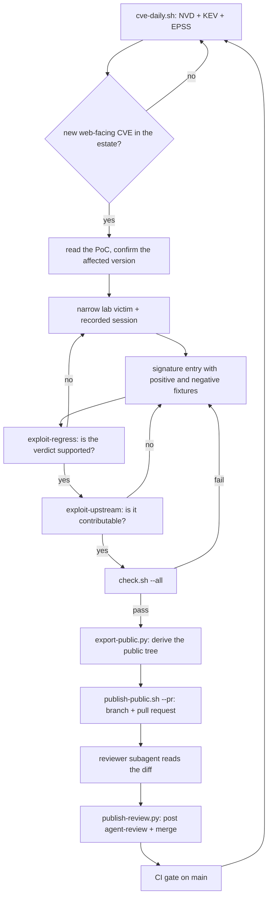

# The agent release loop

The goal this document serves: a new exploit is understood, encoded, proven and published without a
human performing any step. Not "the agent drafts and a human approves" - the review is performed by an
agent, and GitHub enforces that it happened.

## Stages



## Commands, in order

```bash
# 1. what happened today
bin/cve-daily.sh                       # queue.json, poc.json, delta.md

# 2. the work: signature, evidence, ledger - see the exploit-signature-pipeline skill

# 3. both gates
.venv/bin/python bin/exploit-regress.py     # is the verdict supported by a run?
.venv/bin/python bin/exploit-upstream.py    # is the evidence publishable?
bin/check.sh --all                          # fmt, clippy, tests, store, ledger, upstream

# 4. publish as a pull request, not a push
git add -A && git commit -m "signatures: CVE-XXXX-YYYY ..."
bin/publish-public.sh --worktree ~/src/fleet-filter-public --token-file /tmp/ff-token --pr \
    --message "signatures: CVE-XXXX-YYYY ..."
BRANCH=$(git -C ~/src/fleet-filter-public rev-parse --abbrev-ref HEAD)
PR=$(bin/publish-open-pr.py --branch "$BRANCH" --title "signatures: CVE-XXXX-YYYY")

# 5. the review: the agent reads the diff, then states a verdict
bin/publish-review.py --pr "$PR" --show-diff > /tmp/release.diff
#    (reviewer subagent reads /tmp/release.diff and returns PASS/FAIL + notes)
bin/publish-review.py --pr "$PR" --verdict pass --no-merge --notes "..."
bin/publish-review.py --pr "$PR" --merge-only      # after `gate` reports

# 6. confirm
bin/apply-github-settings.py --verify-only
```

## Why the review is a check, not an approval

An app cannot approve its own pull request, and a ruleset cannot exempt an app from a classic
approval requirement. So requiring an approval makes automated publishing impossible, and requiring
nothing makes the review decorative.

A required **check** is the way out: it is enforced by the same ruleset, it can be produced by the
publishing identity, and it is recorded on the commit with its notes attached. The ruleset on `main`
requires:

| requirement | value |
|---|---|
| pull request | required |
| approvals | 0 - the review is the `agent-review` check |
| required checks | `gate`, `agent-review` |
| branches up to date | required |
| linear history | required |
| force push / deletion | refused |
| bypass actors | none - the release job earns its merge like anyone else |

The honest limit: `publish-review.py` records a verdict, it cannot verify one. If a caller passes
`--verdict pass` without a reviewer, GitHub will believe it. The gate is therefore only as good as the
caller, which is why the caller is the reviewer subagent and why its notes are posted verbatim.

## Guardrails that make the loop safe unattended

- **Deterministic export.** Two exports of one commit are byte-identical, and the rendered policies
  are stamped with the signature store's last change rather than the clock, so a release shows only
  what actually changed.
- **The exporter refuses.** A forbidden token (organisation name, private address, operator account)
  aborts the export. It also formats what it rewrote, so CI cannot fail on formatting the export
  introduced.
- **No force push.** The publisher commits the delta to a persistent clone and fast-forwards; if it
  is behind, it stops and says so.
- **A failed review leaves the PR open.** There is no path where a `fail` merges, and a merge that is
  refused because a check has not reported yet is retried, not forced.
- **Tokens never touch disk or argv.** The installation token is minted per run, held in memory, and
  passed through the environment for git.

## What is still manual, deliberately

- **PoC acquisition and lab provision.** Sourcing a proof of concept and standing up a victim is the
  part that needs judgement about what may be run where. The repository supplies the harness, not an
  autonomous lab.
- **Adding a permission to the GitHub App** and approving it for the installation, because GitHub
  requires a human for that on purpose.

## Failure modes and what happens

| failure | result |
|---|---|
| `check.sh` fails | nothing is committed to the release branch; fix and re-run |
| exporter refuses | publish aborts before the branch exists |
| `gate` fails on the PR | merge refused; PR stays open with the failing run attached |
| reviewer returns `fail` | `agent-review` is a failure, merge refused, notes recorded on the commit |
| merge refused (405) | retried with `--merge-only` after the checks land |
